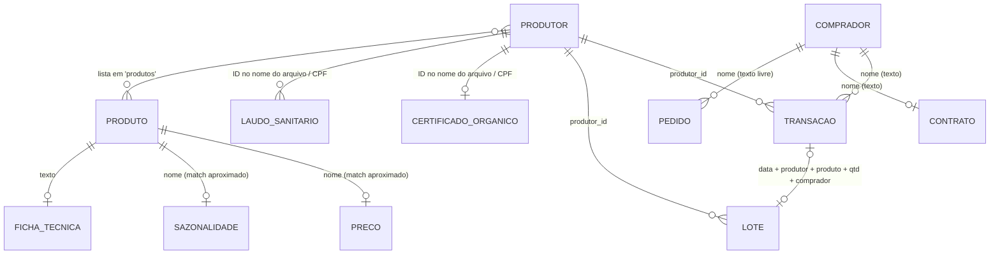

# Dados da Cooperativa Sabor da Terra — Visão Geral

Documentação do conjunto de dados em [`dados/Facepe/`](../dados/Facepe/), que serve de base para o assistente de IA **SaborDaTerraAI**. Os dados são **simulados** (material do Projeto Intermediário) e descrevem a operação de uma cooperativa de agricultura familiar do Agreste Meridional de Pernambuco, com sede em Garanhuns.

> **Contexto do projeto:** o assistente atende a **equipe da cooperativa** (Dona Lúcia e Seu Antônio) em três frentes: triagem de pedidos, consulta à base de documentos com citação de fontes e comunicação com produtores. A entrega da arquitetura é em **19/11/2026** e a demonstração em 20–21/11. O alinhamento entre requisitos e dados, as perguntas de referência e as lacunas conhecidas estão em **[projeto.md](projeto.md)**.
>
> Os dados são uma **amostra** do cenário descrito no enunciado (18 dos 180 produtores, 7 dos 12 municípios, sem dados do PAA).

> **Data de referência:** os dados representam um retrato da operação em **30/10/2026** (data do último pedido recebido). Esta documentação foi escrita em **09/11/2026**; quando um prazo depende da data, as duas referências são indicadas.

## Mapa das fontes

| Fonte | Formato | Volume | O que contém | Doc |
|---|---|---|---|---|
| `produtores.csv` | CSV | 18 linhas | Cadastro dos produtores: dados pessoais, produtos, certificação, dados bancários | [produtores.md](fontes/produtores.md) |
| `pedidos.json` | JSON | 15 mensagens | Caixa de entrada (e-mail, WhatsApp, formulário) de 28–30/10/2026: pedidos, cotações, consultas e uma notificação oficial | [pedidos.md](fontes/pedidos.md) |
| `financeiro.csv` | CSV | 30 transações | Vendas de set–out/2026 com status de pagamento | [financeiro.md](fontes/financeiro.md) |
| `lotes.csv` | CSV | 20 lotes | Rastreabilidade de entregas (colheita → entrega → validade) | [lotes.md](fontes/lotes.md) |
| `tabela_precos_outubro_2026.csv` | CSV | 53 produtos | Preços convencional/orgânico e regras de atacado | [tabela_precos.md](fontes/tabela_precos.md) |
| `sazonalidade.csv` | CSV | 50 produtos × 12 meses | Disponibilidade mensal (alta/média/baixa/nenhuma) | [sazonalidade.md](fontes/sazonalidade.md) |
| `certificacoes/` | 12 TXT | 9 certificados, 2 laudos, 1 relatório | Certificados orgânicos, laudos sanitários e inspeção da ADAGRO | [certificacoes.md](fontes/certificacoes.md) |
| `contratos/` | 3 TXT | 3 contratos | Mercado Bom Preço, PNAE (Prefeitura de Garanhuns), Restaurante Raízes | [contratos.md](fontes/contratos.md) |
| `fichas_tecnicas/` | 5 TXT | 5 fichas | Especificação, produtores, armazenamento e preço de produtos-chave | [fichas_tecnicas.md](fontes/fichas_tecnicas.md) |

Todos os arquivos estão em UTF-8. Os CSVs usam vírgula como separador, ponto como separador decimal e aspas em campos com vírgulas (ex.: lista de produtos). Datas nos CSVs/JSON seguem ISO 8601 (`AAAA-MM-DD`); nos TXT seguem `DD/MM/AAAA`.

## A cooperativa em números

- **18 produtores** (17 ativos, 1 inativo) em 7 municípios — Garanhuns concentra 7.
- **9 produtores com certificação orgânica** declarada no cadastro; **8 vigentes**, 1 vencida (P008) e 1 vencendo em 01/12/2026 (P004).
- **R$ 24.634,00** em vendas registradas em set–out/2026: R$ 11.254,00 pagos e **R$ 13.380,00 pendentes**, dos quais R$ 8.690,00 já estavam vencidos em 30/10.
- **15 mensagens pendentes** na caixa de entrada, nenhuma tratada.
- **Inspeção da ADAGRO marcada para 11 e 12/11/2026**, com risco de suspensão do SIE.
- Pessoas-chave: **Lúcia Helena Barros Cavalcanti** (presidente; chamada de "Dona Lúcia" ou "Lúcia" nas mensagens) e **Eng. Agr. João Marcos Ferreira** (responsável técnico).

## Modelo de dados

As fontes estruturadas se ligam pelo **ID do produtor** (`P001`…`P018`). As fontes em texto livre (TXT, mensagens) citam produtores por ID, nome ou CPF e precisam ser extraídas.

**Chaves e joins — o que funciona e o que não funciona:**

| Join | Chave | Qualidade |
|---|---|---|
| produtores ↔ financeiro / lotes | `produtor_id` | ✅ Íntegro. Nome, CPF e chave PIX batem em 100% das linhas. |
| financeiro ↔ lotes | `(data, produtor_id, produto, quantidade_kg, comprador)` | ⚠️ Não há chave compartilhada. 18 dos 20 lotes casam; 12 transações não têm lote. |
| lotes ↔ pedidos | `pedido_id` | ❌ Formatos diferentes (`PED-2026-SEP-003` vs `PED-2026-001`); nenhum lote referencia os pedidos do JSON. |
| produto ↔ preço / sazonalidade | nome do produto | ⚠️ Nomes não normalizados (ex.: `goiaba` / `goiaba paluma` / `goiaba paluma extra`). Ver [tabela_precos.md](fontes/tabela_precos.md#normalização-de-nomes-de-produto). |
| comprador entre fontes | nome em texto | ⚠️ Variações (ex.: `SESC Garanhuns` vs `SESC - Unidade Garanhuns`; `Dona Cremilda - Lanchonete da Feira` vs `Lanchonete da Feira`). |
| produtor ↔ certificado | ID no nome do arquivo (`..._P004.txt`) + CPF no corpo | ✅ Confiável. |

Atributos que **não estão no cadastro** e só existem nos documentos de texto: número de DAP/CAF, registro SIE, área, capacidade produtiva, certificadora e número do certificado. Ver [produtores.md](fontes/produtores.md#atributos-que-só-existem-em-outras-fontes).

## Glossário

| Termo | Significado |
|---|---|
| **DAP / CAF** | Declaração de Aptidão ao Pronaf / Cadastro Nacional da Agricultura Familiar. Comprova que o produtor é agricultor familiar; obrigatório no PNAE. |
| **SIE / SIM / SISBI** | Serviço de Inspeção Estadual / Municipal / Sistema Brasileiro de Inspeção. Registro sanitário obrigatório para vender **produtos de origem animal** (queijo, mel, frango, ovos) a terceiros. |
| **ADAGRO** | Agência de Defesa e Fiscalização Agropecuária de Pernambuco; fiscaliza e concede o SIE. |
| **PNAE** | Programa Nacional de Alimentação Escolar. Pelo menos 30% dos recursos do FNDE vão para a agricultura familiar. |
| **Empenho** | Reserva orçamentária do órgão público; o pagamento ocorre após o atesto do recebimento (aqui, até 45 dias). |
| **Selo Orgânico Brasil / Sisorg** | Selo federal de conformidade orgânica, concedido por certificadoras credenciadas (aqui: IBD e Ecocert). |
| **Selo Arte** | Selo para produtos artesanais de origem animal (Lei 13.680/2018). |
| **Macaxeira** | Mandioca de mesa (aipim). |

## Achados críticos

Problemas que afetam diretamente as respostas do assistente. Cada um está detalhado no doc da fonte.

### Conformidade sanitária e orgânica

1. **Certificação de P008 (Josefa) vencida em 30/09/2026**, mas o cadastro ainda diz `certificacao_organica = sim`. Em 01/10/2026 ela vendeu mel e geleia ao **preço orgânico** com a nota "Certificação orgânica anexa" (FIN-2026-021/022, LOT-2026-0104). → [certificacoes.md](fontes/certificacoes.md)
2. **P017 (frango caipira) não tem SIE.** A ADAGRO abriu não conformidade grave (NC-001, 16/05/2026) e mandou suspender a intermediação de frango **de imediato**. Mesmo assim houve venda em 25/09/2026 (FIN-2026-018, LOT-2026-0103), a tabela de preços ainda lista o produto, o contrato PNAE o inclui e três pedidos pendentes o solicitam.
3. **P011 não tem SIE** ("venda limitada a consumidor final"), mas vendeu queijo para a Lanchonete da Feira, que é pessoa jurídica (FIN-2026-026).
4. **Certificação de P004 (Ana) vence em 01/12/2026.** A renovação deveria ter sido pedida até 01/10/2026 e não há registro de pedido.
5. **Mel de P008 e P018 está com SIE pendente**, segundo a ficha técnica. Para o PNAE, que exige SIE em produto animal, só o mel de P002 é elegível.

### Financeiro

6. **R$ 6.020,00 da Rede SuperBom vencidos desde 18/10** (FIN-2026-013/014). A mesma rede mandou um "PEDIDO URGENTE" de cerca de R$ 11 mil para pagar com boleto de 30 dias, citando um contrato que não existe em `contratos/`.
7. **R$ 2.670,00 do PNAE vencidos desde 23/10** (FIN-2026-005/006/007).
8. **Preços praticados com o PNAE abaixo dos preços do contrato** (ex.: queijo a R$ 31,00 contra R$ 34,00 contratado; mel a R$ 55,00 contra R$ 58,00).

### Qualidade dos dados

9. **A coluna `quantidade_kg` mistura unidades.** Guarda dúzias, unidades e maços (alface "300 unidades", ovos "Preço por dúzia").
10. **Dias da semana errados em pedidos.** PED-2026-001 pede para "sexta (01/nov)", mas 01/11/2026 é domingo. PED-2026-002 pede "terça 04/nov", mas é quarta. O assistente deve confirmar a data com o cliente em vez de supor uma.
11. **CPFs fictícios:** 17 dos 18 CPFs têm dígito verificador inválido. Não use validação de CPF como regra de negócio com estes dados.
12. **Rastreabilidade incompleta:** a ADAGRO pede "os últimos 3 lotes de cada produto", e só queijo coalho e mel silvestre têm 3 lotes registrados.

## Dados sensíveis (LGPD)

O conjunto contém dados pessoais e financeiros de pessoas físicas. O usuário do assistente é a equipe interna, que pode consultar esses dados. O cuidado vale para o **conteúdo que o assistente redige para terceiros** (respostas a compradores, propostas, dossiês): esses textos não devem incluir esses dados sem base legal, e respostas a produtores pressupõem que a equipe verificou a identidade.

| Dado | Onde aparece |
|---|---|
| CPF | `produtores.csv`, `financeiro.csv`, `lotes.csv`, certificados, contratos (representantes e testemunhas), pedidos (PED-004, PED-013, PED-015) |
| Data de nascimento, telefone, e-mail, endereço | `produtores.csv` |
| Banco, agência, conta, chave PIX | `produtores.csv`, `financeiro.csv`, `cert_organica_debora_melo_P018.txt`, contratos (conta da cooperativa) |
| RG | PED-2026-013 |
| Faturamento individual do produtor | `financeiro.csv` |

Pedidos que **solicitam** esses dados e exigem cuidado: PED-2026-009 (Hospital pede CPF e endereço de produtores), PED-2026-010 (lista de produtores), PED-2026-011 (exportadora estrangeira pede lista de produtores e dados bancários), PED-2026-012 (produtora pede o próprio saldo por WhatsApp) e PED-2026-015 (produtor repassa o CPF de um terceiro). Ver [pedidos.md](fontes/pedidos.md#triagem-dos-pedidos).

## Como usar estes docs

- **Vai desenhar a arquitetura ou preparar a demonstração?** Comece por [projeto.md](projeto.md), que tem os requisitos ligados às fontes, as perguntas de referência e as lacunas em que o assistente deve dizer "não encontrei".
- **Vai construir a ingestão ou os embeddings?** Comece pelo schema de cada fonte e pela seção "Qualidade dos dados" do doc correspondente.
- **Vai escrever prompts ou regras do assistente?** Leia [pedidos.md](fontes/pedidos.md), que traz a triagem das 15 mensagens com as fontes e restrições envolvidas em cada uma, e [certificacoes.md](fontes/certificacoes.md), que traz as regras de conformidade.
- **Vai fazer cotações ou checar disponibilidade?** Use [tabela_precos.md](fontes/tabela_precos.md), [sazonalidade.md](fontes/sazonalidade.md) e [fichas_tecnicas.md](fontes/fichas_tecnicas.md), que traz a capacidade semanal por produtor.
